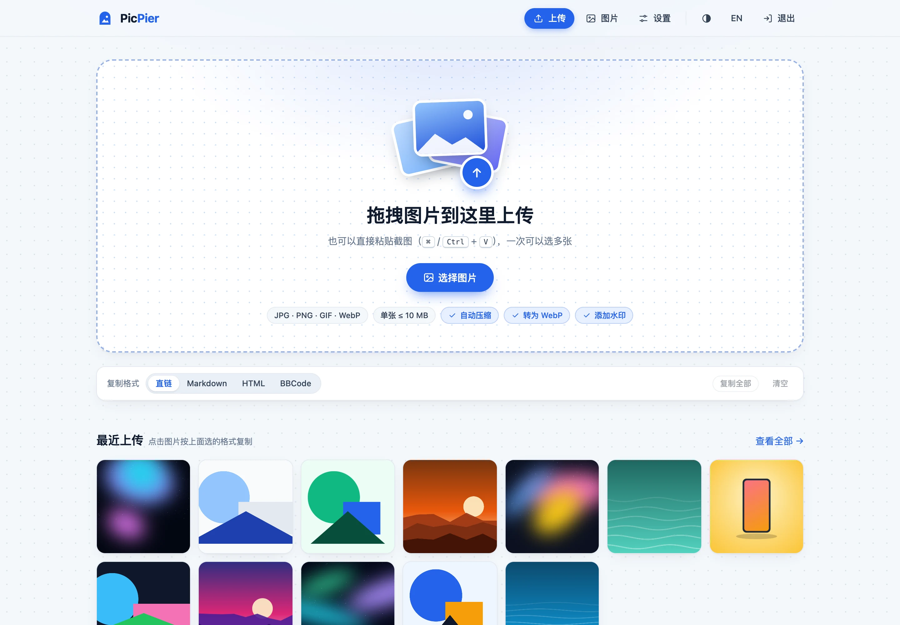
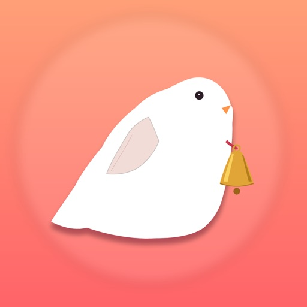
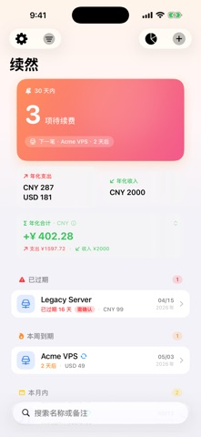

# `Lau0x`

做一些自己会用、也希望别人用得上的小工具。关注自托管、内容发布和 iOS 应用。

**[技术博客 · 我不是咕咕鸽](http://blog.laoda.de/)** &nbsp; / &nbsp; [生活记录 · yirenliu.com](https://yirenliu.com) &nbsp; / &nbsp; [项目展示](https://yirenliu.com/projects/)

## 做的小东西

<table>
  <tr>
    <td width="50%" valign="top">
      
      <h3>PicPier · 图栈</h3>
      
图片有自己的停靠处。

      
用 Go 写的轻量自托管图床，无需 PHP 和数据库。兼容 EasyImage 图片链接与上传 API，也能接入 PicGo。

      
<a href="https://github.com/Lau0x/picpier">查看源码</a> &nbsp;·&nbsp; <a href="https://github.com/Lau0x/picpier/releases/latest">下载安装</a>

      

      
Go &nbsp; / &nbsp; Docker &nbsp; / &nbsp; Self-hosted

    </td>
    <td width="50%" valign="top">
      
      <h3>续然 · DueSub</h3>
      
让下一次续费，心里有数。

      
把订阅、域名和服务器的到期日放在一起，提前提醒。数据默认保存在设备本地，可选 iCloud 私有同步。

      
<a href="https://apps.apple.com/cn/app/id6763448383">在 App Store 下载</a> &nbsp;·&nbsp; <a href="https://yirenliu.com/projects/#duesub">了解应用</a>

      

      
iOS &nbsp; / &nbsp; Reminders &nbsp; / &nbsp; Local-first

    </td>
  </tr>
  <tr>
    <td width="50%" valign="top">
      
      <h3>GongFormat</h3>
      
从 Markdown，到公众号正文。

      
纯前端排版工具，边写边预览，一键复制为微信公众号可粘贴的富文本。

      
<a href="https://github.com/Lau0x/gongformat">查看源码与使用说明</a>

      
Markdown &nbsp; / &nbsp; WeChat &nbsp; / &nbsp; No backend

    </td>
    <td width="50%" valign="top">
      
      <h3>Yu</h3>
      
给文字和生活，留一个安静的地方。

      
注重中文阅读体验的 Hugo 主题，支持说说、相册和深色模式。生活博客正在使用。

      
<a href="https://github.com/Lau0x/hugo-theme-yu">查看源码</a> &nbsp;·&nbsp; <a href="https://yirenliu.com">主题预览</a>

      
Hugo &nbsp; / &nbsp; Chinese typography &nbsp; / &nbsp; Journaling

    </td>
  </tr>
</table>

### 也在维护

**[Halo Theme Joe3 · Next](https://github.com/Lau0x/halo-theme-joe-next)**：在 Jiewenhuang 的 [Joe3.0](https://github.com/jiewenhuang/halo-theme-joe3.0) 基础上继续维护的 Halo 2.x 主题，也是[技术博客](http://blog.laoda.de/)正在使用的主题。

使用中遇到问题，欢迎到对应项目提 Issue。
